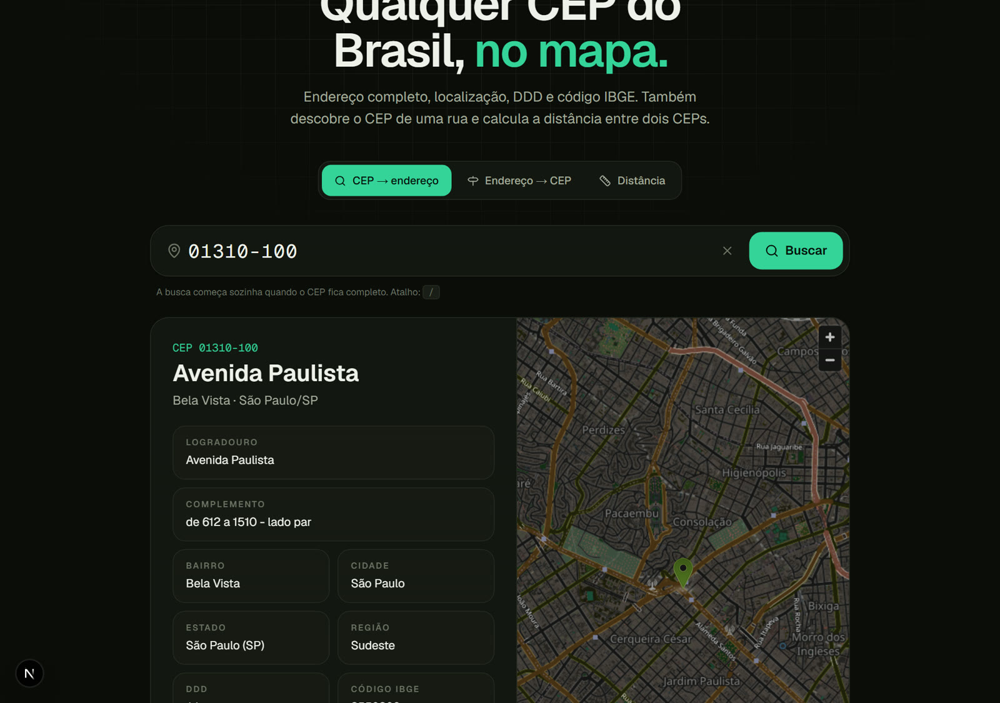

# Busca CEP

Qualquer CEP do Brasil, no mapa. Endereço completo, localização, DDD e código IBGE; também descobre o CEP de uma rua e calcula a distância entre dois CEPs.

**Ao vivo:** https://busca-cep-steel.vercel.app



## O que dá para fazer

- **CEP → endereço** com máscara, busca automática ao completar os 8 dígitos e atalho `/` para focar o campo
- **Mapa** da rua (ou do centro da cidade, quando o CEP é geral) pelo OpenStreetMap
- **Endereço → CEP**: escolha estado, cidade e rua e veja todos os CEPs, com bairro e faixa de numeração
- **Distância entre dois CEPs** em linha reta, com link para a rota
- **Copiar** endereço formatado, CEP ou um **link compartilhável** (`?cep=01310100`)
- **Histórico** das últimas buscas salvo no navegador
- **Tema claro e escuro**, layout para celular e acessibilidade (rótulos, foco, `aria-live`)

## Como funciona

As consultas passam por rotas do próprio Next.js (`/api/cep/[cep]` e `/api/endereco`), não direto do navegador:

- **Reserva automática:** tenta o ViaCEP e, se ele estiver fora do ar ou não conhecer o CEP, usa a BrasilAPI.
- **Cache no servidor** com `use cache` (Cache Components do Next 16): o mesmo CEP não vai de novo às APIs por dias. Erros de serviço não entram no cache.
- **Localização** pelo Nominatim (OpenStreetMap), tentando primeiro a rua e depois a cidade, também cacheada.
- **Respostas claras** para CEP inválido (400), não encontrado (404) e serviços fora do ar (503).

## Stack

Next.js 16 (App Router, Cache Components) · React 19 · TypeScript · Tailwind CSS v4 · lucide-react

## Rodando

```bash
npm install
npm run dev
```

Dados: [ViaCEP](https://viacep.com.br), [BrasilAPI](https://brasilapi.com.br) e [© OpenStreetMap](https://www.openstreetmap.org/copyright).
